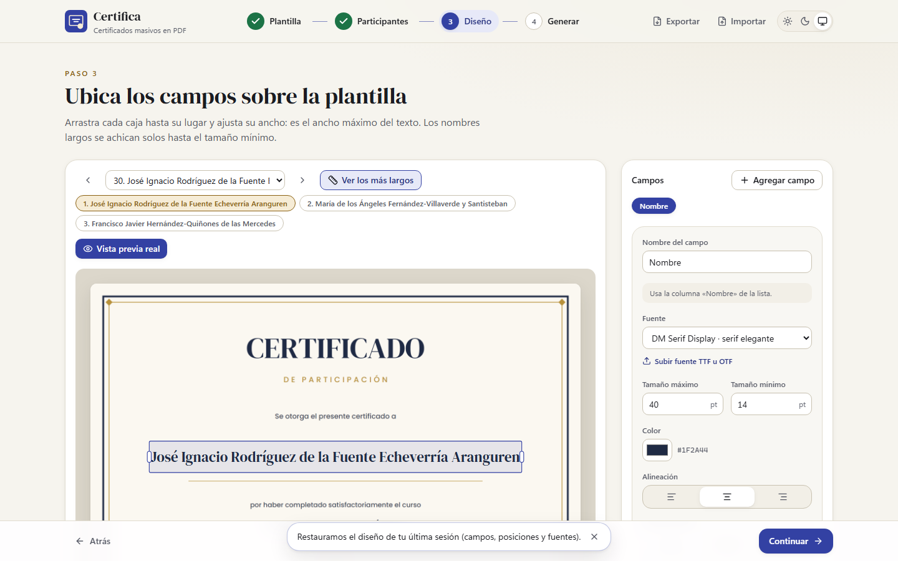

# Certifica — Generador masivo de certificados

Genera cientos de certificados en PDF a partir de una plantilla y una lista de participantes, **directamente en el navegador**. Ningún archivo se sube a un servidor: la plantilla, la lista y los PDF generados nunca salen de tu equipo.



- **Formatos de entrada:** plantilla en PDF, PNG o JPG; lista en TXT, CSV (UTF-8 o Windows-1252), Excel (.xlsx) o Word (.docx).
- **Formatos de salida:** un ZIP con un PDF por participante (más `reporte.csv`), un solo PDF con todos, o ambos.
- **Volumen:** 360 participantes se generan en unos 8 segundos y la interfaz no se congela, porque el trabajo corre en un Web Worker. Probado hasta 1000.
- **Español completo:** tildes, ñ, ü, apóstrofes (O'Connor) y guiones (María-José), con fuentes incrustadas.

---

## Uso paso a paso

### 1. Plantilla

Arrastra el diseño del certificado **sin los nombres**, o haz clic para elegirlo.

- Se aceptan PDF, PNG y JPG, horizontales o verticales y de cualquier tamaño.
- Verás la miniatura, el tamaño de página, la orientación y el peso.
- Si el PDF tiene varias páginas, se usa la primera.
- Si la imagen pesa más de 1 MB, aparece el botón **Optimizar**: la convierte a JPG (calidad 85 %) para que los PDF pesen mucho menos. Si la imagen tiene transparencia, primero te avisa, porque esas zonas quedarán blancas.

### 2. Participantes

Arrastra la lista.

- **TXT o Word (.docx):** un nombre por línea o párrafo.
- **CSV o Excel:** una fila por persona. Se detecta el encabezado y la columna de nombres (`Nombre`, `Nombres`, `Participante`, `Name`, `Full name`…), y puedes elegir otra en el selector.
- Se limpian los espacios dobles, los caracteres invisibles y las líneas vacías.
- Los nombres repetidos se **marcan** (comparando sin tildes ni mayúsculas), pero no se eliminan.
- Puedes buscar, revisar página por página y corregir un nombre con el lápiz ✎.

### 3. Diseño

- Arrastra la caja del nombre hasta su lugar y ajusta su ancho con las asas laterales. **El ancho de la caja es el ancho máximo del texto:** los nombres largos se achican solos hasta el tamaño mínimo.
- La caja se alinea sola al centro de la página. Con el teclado: flechas para mover (Mayús = pasos grandes) y Alt + flechas para cambiar el ancho.
- En el panel lateral eliges fuente, tamaño máximo y mínimo, color, alineación y transformación (ninguna, Título o MAYÚSCULAS).
- **Agregar campo:** un código correlativo (por ejemplo `CERT-2026-{n:000}` → `CERT-2026-001`), otra columna de la lista (curso, fecha…) o un texto fijo.
- **Ver los más largos** muestra los 3 nombres que ocupan más ancho. **Vista previa real** genera el PDF de un participante tal como saldrá.
- Si algún nombre no entra ni al tamaño mínimo, se marca en rojo y se lista antes de generar.

### 4. Generar

Elige ZIP, PDF único o ambos.

- Verás el peso estimado y, mientras se genera, el progreso (por ejemplo, 123/360) con el tiempo restante. Puedes cancelar en cualquier momento.
- Al terminar, descarga los archivos. El ZIP incluye `reporte.csv` con índice, nombre, archivo, código y si hubo desborde.
- Los archivos se llaman `001_Maria_Jose_Lopez.pdf`: el número evita choques entre nombres repetidos, y las tildes se quitan solo del nombre del archivo, nunca del certificado.

### Reutilizar el diseño en otro evento

Con **Exportar** (arriba a la derecha) descargas un `configuracion-certificados.json` con los campos, posiciones y fuentes. Con **Importar** lo cargas en otro evento.

- El navegador también recuerda tu último diseño (solo la configuración, nunca los archivos).
- Si la configuración usa una fuente subida que ya no está disponible, se reemplaza por DM Serif Display y se te avisa.

---

## Recomendaciones para la plantilla

- **Exporta desde Canva como PDF** (Compartir → Descargar → _PDF estándar_) y **deja vacío el espacio del nombre**. El PDF conserva la calidad vectorial y pesa poco.
- Si exportas como imagen, usa PNG o JPG a 150–200 ppp. Si pesa más de 1 MB, usa **Optimizar**.
- **El peso de la plantilla se repite en cada PDF del ZIP.** Una plantilla de 7 MB produce un ZIP de unos 2,4 GB para 360 personas. En el **PDF único**, en cambio, la plantilla se incrusta una sola vez.
- Los PDF protegidos con contraseña o con restricciones no se pueden usar: expórtalos de nuevo sin protección.

## Formatos aceptados

| Entrada       | Formatos                                         | Notas                                                                                                                       |
| ------------- | ------------------------------------------------ | --------------------------------------------------------------------------------------------------------------------------- |
| Plantilla     | `.pdf`, `.png`, `.jpg`/`.jpeg`                   | Se detecta por el contenido, no por la extensión. Se respetan `/Rotate`, CropBox y la orientación EXIF de las fotos.        |
| Lista         | `.txt`, `.csv`, `.tsv`, `.xlsx`, `.xls`, `.docx` | Codificación UTF-8, UTF-16 o Windows-1252 (CSV de Excel en Windows), detectada sola. CSV separado por `,` `;` tabulador o ` | `.  |
| Fuente propia | `.ttf`, `.otf`                                   | Se sube en el paso Diseño. Se avisa si le faltan caracteres del español o si es variable (se usa su grosor por defecto).    |
| Configuración | `.json`                                          | Exportada desde la app.                                                                                                     |

## Fuentes

Incluidas (licencia SIL Open Font License, en `public/fonts/<id>/OFL.txt`):

| Fuente                  | Estilo                                      |
| ----------------------- | ------------------------------------------- |
| DM Serif Display        | Serif elegante (por defecto para el nombre) |
| Poppins Medium          | Sans moderna                                |
| Great Vibes             | Caligráfica                                 |
| Barlow Condensed Medium | Sans condensada                             |
| Marcellus               | Clásica                                     |

**Usar una fuente propia en un evento:** en el paso Diseño, "Subir fuente TTF u OTF". Queda solo en memoria durante la sesión.

**Agregar una fuente al proyecto:**

1. Copia el TTF estático y su `OFL.txt` en `public/fonts/<id>/` (o agrégala a `FONT_SOURCES` en `scripts/download-fonts.ts` y corre `npm run fonts`).
2. Regístrala en `src/infrastructure/fonts/bundled-fonts.ts` con su `id`, `name`, `category`, `subset: true` y `path`.
3. Corre `npm test`: `tests/integration/fonts.test.ts` verifica que tenga todos los caracteres del español y que se vea igual recortada (_subset_) que completa. Si una fuente fallara al recortarse, pon `subset: false` solo para ella.

---

## Desarrollo

Requisitos: Node.js 22.13 o superior (probado con Node 24) y npm.

```bash
npm install
npx playwright install chromium   # solo para los E2E
npm run dev                        # http://localhost:5173
```

| Script                  | Qué hace                                                                           |
| ----------------------- | ---------------------------------------------------------------------------------- |
| `npm run dev`           | Servidor de desarrollo.                                                            |
| `npm run build`         | Typecheck y build de producción en `dist/`.                                        |
| `npm run preview`       | Sirve `dist/` en http://localhost:4173 con las cabeceras de producción.            |
| `npm run lint`          | ESLint (incluye las reglas de capas) y Prettier.                                   |
| `npm run typecheck`     | TypeScript estricto (app, worker y scripts).                                       |
| `npm test`              | Unitarios, integración y componentes (Vitest), con cobertura.                      |
| `npm run test:e2e`      | Playwright contra el build de producción.                                          |
| `npm run check`         | lint + typecheck + test + build.                                                   |
| `npm run fixtures`      | Regenera los archivos de prueba en `fixtures/` (se corre solo antes de los tests). |
| `npm run verify:render` | Renderiza certificados de verificación a PNG en `docs/verification/`.              |
| `npm run metrics`       | Mide tiempos y pesos de 360 certificados en Node.                                  |
| `npm run screenshots`   | Captura las pantallas de `docs/screenshots/`.                                      |

### Arquitectura

```
src/
  domain/          Reglas puras: normalización, título, duplicados, ajuste de texto, geometría,
                   nombres de archivo, códigos, configuración. Sin librerías.
  application/     Casos de uso y puertos (interfaces). Solo dependen de domain.
  infrastructure/  Adaptadores: parsers (PapaParse, SheetJS, mammoth), pdf-lib, pdf.js, JSZip,
                   fuentes, canvas, localStorage, cliente del Web Worker.
  workers/         Worker de generación (protocolo tipado, progreso, cancelación).
  ui/              React: pasos, componentes, hooks y store (Zustand).
  composition-root.ts   Único lugar que conecta adaptadores y casos de uso.
```

ESLint impone las reglas de dependencia: `domain` no importa nada de las otras capas; `application` solo `domain`; la UI nunca llama a pdf-lib, pdf.js, JSZip ni a los parsers. El detalle está en [`PLAN.md`](PLAN.md), y el registro de cada fase, con sus métricas y decisiones, en [`PROGRESS.md`](PROGRESS.md).

---

## Despliegue en Vercel

Es un sitio estático: no necesita servidor ni variables de entorno.

1. Sube el repositorio a GitHub, GitLab o Bitbucket.
2. En Vercel: **Add New → Project** e importa el repositorio. `vercel.json` ya define el framework (Vite), `npm run build` y la carpeta `dist`.
3. Despliega. Cada push a la rama principal publica una versión nueva.

Con la CLI: `npm i -g vercel`, luego `vercel` (preview) y `vercel --prod`.

`vercel.json` también define:

- **Cabeceras de seguridad:** una CSP estricta (solo recursos propios, `wasm-unsafe-eval` para los decodificadores de pdf.js), `nosniff`, `no-referrer`, `Permissions-Policy` y COOP.
- **Caché:** larga para `/assets` (nombres con hash) y de 7 días para fuentes y assets de pdf.js.

Las mismas cabeceras se aplican en `npm run preview` (`deploy/headers.ts`), así que los E2E corren con la CSP real. Cualquier otro hosting estático (Netlify, GitHub Pages, Cloudflare Pages) sirve igual: publica `dist/`.

## Compatibilidad

Navegadores modernos de escritorio y tablet: Chrome, Edge, Firefox y Safari recientes, con soporte de Web Workers de módulo. Las pruebas automatizadas corren en Chromium.
